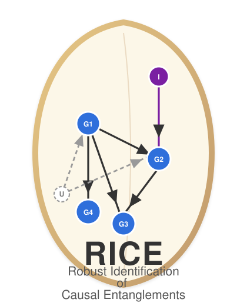

# RICE 

**R**obust **I**dentification of **C**ausal **E**ntanglements

RICE estimates a directed causal gene network from single-cell perturbation screens. It
models raw UMI counts with negative binomial regression, uses transformed expression as
candidate regulatory predictors, and learns a sparse acyclic network under an acyclicity
constraint. A gene-matched residual adjustment reduces spurious edges caused by shared
unmeasured variation.

The repository has two parts, which are independent of each other:

- **[Part 1 — run RICE on your own data](#part-1--run-rice-on-your-own-data)**: `rice/`
- **[Part 2 — reproduce the manuscript](#part-2--reproduce-the-manuscript)**: `reproduction/`

```bash
git clone https://github.com/HowardGech/RICE.git
cd RICE
pip install -r requirements.txt       # CuPy must match your CUDA version
```

Fitting requires a GPU: the model imports CuPy at module scope. Everything else —
preprocessing, input checks, thresholding, the figures — runs on CPU.

---

# Part 1 — run RICE on your own data

Everything needed is in `rice/`. A run is fully described by two things: the command line,
which says where your files are, and `config.json`, which says what the parameters are.

## Quick start

```bash
cd rice
python run_rice.py --counts example_data/counts.csv \
                   --perturbations example_data/perturbations.csv \
                   --out results/ --dry-run      # checks the inputs, no GPU needed
python run_rice.py --counts example_data/counts.csv \
                   --perturbations example_data/perturbations.csv \
                   --out results/                # fits the network
```

`--dry-run` loads and validates everything and stops before fitting. Use it first: it
catches a transposed matrix or a mis-coded design in seconds, without queueing a GPU job.

## Your data

| argument | what it is |
|---|---|
| `--counts` | cells × genes matrix of **raw UMI counts** (`.csv`, `.tsv`, `.npy`, `.npz`, `.h5ad`) |
| `--perturbations` | cells × genes matrix of 0/1: 1 where that gene was targeted in that cell |
| `--covariates` | optional cells × k matrix to adjust for (batch, cell cycle, ...) |
| `--gene-names` | optional, one name per line; taken from the `.h5ad` var index when available |

Both matrices must be cells × genes **in the same gene order**; the input check reports the
two shapes if they disagree. A cell with no perturbation is a control.

For AnnData input you can skip `--perturbations` and let the design be built from a column
of `adata.obs`:

```bash
python run_rice.py --counts screen.h5ad --perturbation-column gene_id \
                   --control-label non-targeting --out results/
```

Labels naming several genes (`"BRCA1,TP53"`) set one entry each; labels that are not gene
columns are reported and ignored.

## Parameters: `config.json`

Edit the file, or override single entries on the command line with
`--set section.key=value` (repeatable). Unknown keys and invalid values are errors, not
warnings, so a typo cannot silently fall back to a default.

```bash
python run_rice.py ... --set model.pen1=1e-3 --set control_function.mode=full
```

| section | key | meaning |
|---|---|---|
| `preprocessing` | `transform` | `log1p_offset` (divide by a per-cell size factor first), `log1p`, `none` |
| | `size_factor` | `total_umi_per_gene`, `total_umi`, `none` |
| | `standardize` | centre and scale each gene; coefficients are then in SD of the target gene |
| `control_function` | `mode` | `gene_matched` (each gene on its own indicator — the form used in the paper), `full` (on every indicator), `none` |
| | `include_covariates` | put `--covariates` in the first stage as well |
| `model` | `intervention_type` | `soft` (CRISPRi, partial knockdown) or `hard` (knockout) |
| | `regularizer` | `binsum` or `expm` acyclicity penalty |
| | `pen1`, `pen2` | L1 and L2 penalties on the network weights |
| | `pen1_c`, `pen2_c` | the same for the control-function coefficients |
| | `lr`, `max_iter`, `epochs`, `h_tol`, `loss_tol` | optimiser settings |
| | `dtype`, `seed`, `verbose` | `float64` is the default and is recommended |
| `thresholding` | `method` | `changepoint` (break in the sorted weights), `fixed` (use `w_threshold`), `none` |
| | `to_dag` | drop the weakest edge of any cycle so the result is acyclic |
| `output` | `save_weighted_matrix`, `save_edge_list`, `min_abs_weight_in_edge_list` | what to write |

## What you get

In `--out`, prefixed with `--prefix` (default `rice`):

- `rice_network.npz` — `W_raw` (all fitted weights), `W_est` (thresholded, acyclic), `genes`
- `rice_edges.csv` — `regulator, target, weight`, sorted by |weight|
- `rice_run.json` — the resolved config, the input summary, the threshold, the edge count
  and the runtime, so a result can be traced back to the settings that produced it

`example_data/` holds a 600-cell, 15-gene simulated screen and the true network it was drawn
from, for checking that the pipeline runs end to end.

Two things worth knowing. `thresholding.method: "changepoint"` cuts at the largest break in
the sorted weights, which is the procedure used in the paper; on small or unusual weight
distributions it can cut low and keep near-zero edges, and `fixed` with an explicit
`w_threshold` is the alternative. And `standardize: true` puts the weights in standard
deviations of the target gene, which is what makes them comparable across genes.

---

# Part 2 — reproduce the manuscript

Everything in `reproduction/`. Set the paths once:

```bash
export PYTHONPATH=$PWD/rice:$PWD/reproduction/simulation:$PWD/reproduction/perturbseq
export SCGRAPH_DIR=$PWD/reproduction/simulation
```

## Simulations

```
reproduction/simulation/
  sim_base.py          simulate_NB_tgt and relatives: the generator everything else builds on
  sim_*.py             one assumption violation each (see table below)
  gen_simulation.py    original generator driver; run_simulation.py fits RICE; example.ipynb
  drivers/             generate_<arm>.py writes one replicate, fit_<arm>.py runs RICE on it
  submit/              LSF array scripts; CODE, DATA and PY come from the environment
  analysis/            sortability, ordering baselines, control-function comparison
  figures/             the manuscript figures and the LaTeX table
```

| generator | violation |
|---|---|
| `sim_crossguide.py` | a guide acts directly on a gene other than its target |
| `sim_invalid_guides.py` | a fraction of matched guides act on the wrong gene |
| `sim_nonlinear_confounding.py` | nonlinear, non-additive latent-factor effects |
| `sim_dependent_assignment.py` | perturbation assignment depends on the latent state |
| `sim_sparse_confounding.py` | latent factors load on a sparse subset of genes |
| `sim_partial_efficacy.py` | partial knockdown at a given per-gene efficacy |
| `sim_guide_mismatch.py`, `sim_guide_mismatch_cells.py` | guide-to-cell misassignment |

Each arm has a severity knob whose zero setting reproduces `sim_base` exactly, so an arm is
compared against a no-violation reference from the same graph and random state. Every
generator ships a `--selftest` that checks this; all of them pass as committed.

```bash
python reproduction/simulation/sim_crossguide.py --selftest
```

`sim_base.simulate_NB_tgt` takes `apply_clip`, which guards an overflow that otherwise
produces negative counts. It defaults to `False`, reproducing the published generator
exactly; `True` changes ordinary draws as well, so clipped and unclipped runs must not be
pooled.

## Real screens

`reproduction/perturbseq/` analyses the K562 and RPE1 CRISPRi screens of
[Replogle et al. (2022)](https://www.sciencedirect.com/science/article/pii/S0092867422005979)
(processed data on [Figshare](https://plus.figshare.com/articles/dataset/_Mapping_information-rich_genotype-phenotype_landscapes_with_genome-scale_Perturb-seq_Replogle_et_al_2022_processed_Perturb-seq_datasets/20029387)):
`run_Replogle_2022.py` fits the networks, `topk_significance.py` and `compute_ate.py` build
the held-out comparisons, and `cells/` holds the notebook cells that draw each figure.

## Provenance

`reproduction/docs/MANIFEST.md` lists every file with what it does and how far it has been
verified — which scripts have passing self-tests, which were only syntax-checked, and which
need a GPU — plus the design notes for each sensitivity arm.

## License

See `LICENSE`.
